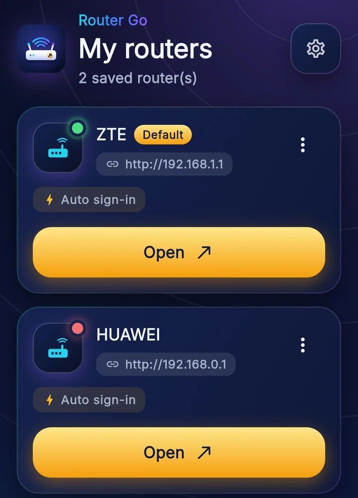

# Router Go

**افتح صفحة إدارة الراوتر بضغطة واحدة** · *Open your router's admin page in one tap*

تطبيق لأندرويد وويندوز: بيحفظ بيانات الراوتر بتاعك ويفتح صفحته ويسجّل الدخول لوحده. مجاني، من غير إعلانات ولا حساب ولا تتبّع.

## التحميل

| المنصة | الملف |
|---|---|
| أندرويد | [router-go.apk](https://github.com/saqr365/router-go/releases/latest/download/router-go.apk) |
| ويندوز 10 / 11 | [RouterGo-Setup.exe](https://github.com/saqr365/router-go/releases/latest/download/RouterGo-Setup.exe) |

- كل الإصدارات وملاحظاتها: [Releases](https://github.com/saqr365/router-go/releases)
- الموقع: <https://saqr365.github.io/router-go/>
- سياسة الخصوصية: <https://saqr365.github.io/router-go/privacy.html>

## المميزات

- احفظ أكتر من راوتر، وحدد واحد كراوتر افتراضي.
- اكتشاف عنوان الراوتر (البوابة) تلقائيًا.
- تسجيل دخول تلقائي لصفحة الراوتر. بيحاول مرة واحدة بس في كل مرة، فلو كلمة السر غلط مابيكررش ومش هيقفل الراوتر. ومابيشتغلش غير على عنوان الراوتر المحفوظ.
- بيانات الدخول بتتخزّن مشفّرة في التخزين الآمن للنظام على جهازك.
- اختبار الاتصال بالراوتر.
- قايمة أجهزة لكل راوتر (الاسم وMAC وIP). دي بيانات إنت اللي بتكتبها، مش فحص للشبكة.
- صفحات مفضلة جوه إعدادات الراوتر، تفتحها بضغطة.
- اختصارات لاختبار سرعة الإنترنت: Speedtest وFast وCloudflare.
- قفل التطبيق بـ PIN، وبالبصمة على أندرويد وWindows Hello على ويندوز.
- تصدير واستيراد البيانات (JSON).
- عربي وإنجليزي، وفاتح وداكن.
- ويدجت أندرويد اختياري.

## التثبيت

**أندرويد:** نزّل `router-go.apk` وافتحه. لو أندرويد طلب، اسمح بالتثبيت من مصادر غير معروفة للمتصفح اللي نزّلت منه.

**ويندوز:** نزّل `RouterGo-Setup.exe` وشغّله. الدخول التلقائي بيحتاج WebView2 Runtime، وغالبًا موجود في ويندوز 10 و11. لو مش موجود، التطبيق بيعرض عليك تفتح الراوتر في المتصفح.

## الخصوصية

التطبيق مابيجمعش أي بيانات عنك ومابيبعتهاش لأي سيرفر. كل حاجة بتتخزّن على جهازك بس. التفاصيل في [سياسة الخصوصية](https://saqr365.github.io/router-go/privacy.html).

## الترخيص

© 2026 محمود صقر. جميع الحقوق محفوظة.
المستودع ده فيه موقع التطبيق بس. كود التطبيق مش منشور ومش مفتوح المصدر.

## المطوّر

محمود صقر (Mahmoud Saqr) · [github.com/saqr365](https://github.com/saqr365)

---

## English

**Router Go** opens your router's admin page in one tap, and signs in for you. Android and Windows. Free, no ads, no accounts, no tracking.

- **Download:** [Android APK](https://github.com/saqr365/router-go/releases/latest/download/router-go.apk) · [Windows installer](https://github.com/saqr365/router-go/releases/latest/download/RouterGo-Setup.exe) · [all releases](https://github.com/saqr365/router-go/releases)
- **Website:** <https://saqr365.github.io/router-go/>
- **Features:** several saved routers, gateway detection, one-tap auto sign-in (one attempt only, and only on the saved router's address), credentials kept in the system's secure storage, connection test, a per-router device list (name, MAC, IP: entries you add yourself), favorite pages inside the router's settings, speed-test shortcuts, app lock (PIN, fingerprint, Windows Hello), JSON export/import, Arabic and English, light and dark themes, and an optional Android widget.
- **Windows:** auto sign-in needs the WebView2 Runtime (usually already on Windows 10/11); otherwise the app offers to open the router in your browser.
- **Android:** the APK is installed from this site, not from a store, so Android may ask you to allow installs from unknown sources.
- **Privacy:** the app collects no data and sends nothing to any server. See the [privacy policy](https://saqr365.github.io/router-go/privacy.html).
- **License:** © 2026 Mahmoud Saqr. All rights reserved. This repository contains the website only; the app's source code is not published and is not open source.
